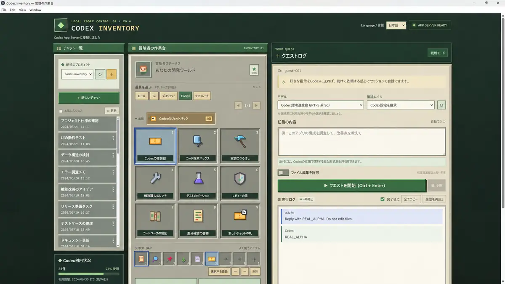

# Codex Inventory v0.6

**言語：日本語 | [English](README.md)**



<sub>スクリーンショットはチャット履歴をダミーに置き換え、パスとチャットIDを匿名化しています。</sub>

**A pixel-art, local-first desktop UI for Codex App Server.** An independent, community-developed project for Windows 11. Browse conversations, monitor usage, and review explicit command/file/network permission requests without leaving the app.

ローカルで動く、ピクセルアート風のCodex App Serverクライアントです。チャット一覧、複数スレッドの並行実行、Codexの利用枠表示に対応します。

> **非公式のコミュニティ開発アプリです。** OpenAIによる開発・後援・認定・サポートは受けていません。Codex CLIやログイン情報は同梱しておらず、利用者自身のCodex環境が必要です。

### Open source / OSS

Source code: **[MIT License](LICENSE)** (copyright © 2026 morio-23). Contributions are welcome; please read [CONTRIBUTING.md](CONTRIBUTING.md). To report a vulnerability privately, see [SECURITY.md](SECURITY.md).

**配布状況（2026年10月23日確認）：** [v0.6.0-beta.1](https://github.com/morio-23/codex-inventory/releases/tag/v0.6.0-beta.1) はWindows Setup/Portable EXEとSHA-256を公開済みです。一方、v0.7のWindows EXEは未公開で、実CodexとWindowsでの受け入れ確認が残っています。[v0.7公開準備の判定資料](V07_RELEASE_READINESS.ja.md)を参照してください。

**公開ソース：** MITライセンスのOSSとして新しいGit履歴で公開しています。GitHub Actionsは手動実行のみ。過去のβ版EXE公開はv0.7の安全性・動作を保証するものではありません。[ローカルテスト手順](PUBLICATION_CHECKLIST.ja.md)を参照してください。

## 本体UIの言語切替（日本語・英語）

アプリ本体はOS・ブラウザの言語設定から初回言語を自動選択し、画面右上の **Language / 言語** で日本語・英語を即時切替できます。選択内容はローカルに保存され、再起動後も維持されます。

切替によって**既存の会話本文、ユーザー作成テンプレート、入力途中の文章、ファイル内容、ワークスペースのIDは変更・翻訳・再送信しません**。標準アイテム、主要UI、チケット使用確認、承認ボタン、標準プロンプト16件は日英に対応します。古いCodex CLIやローカルスクリプトが直接返すエラー文などは元の言語で表示される場合があります。

言語切替とチケット・承認のE2Eを追加していますが、Windows EXEや実Codexでの最終受け入れは引き続き [Windows版受け入れ手順](RELEASE_ACCEPTANCE.ja.md) の公開ゲートが必要です。

## モデル・推論レベル選択（Codex App Server公式API）

クエストログの入力欄の上に「モデル」「推論レベル」の選択欄があります。接続中のCodex App Server `model/list` を読み取り、**現在利用できるモデルが対応すると明示している推論レベルだけ**を順序どおりに表示します。`low / medium / high / xhigh / max / ultra`などの値は、実際に各モデルが返したものだけ選択できます。

- **Codex設定を継承**：そのチャットの現在のモデル・推論設定を変更しません。最初はこの状態なので既存ユーザーの実行方式は変わりません。
- モデルと推論レベルを選ぶと、次の`turn/start`リクエストの**`model`と`effort`に反映**します。**モデルだけ指定した場合は、そのモデルが広告する標準推論レベル**を指定して旧スレッドの非対応推論レベルの継承を防ぎます。推論レベルだけを指定した場合、App Serverのモデル一覧にある既定モデルを明示して使います。
- **既存チャットも変更できます**。公式APIのturn overrideはスレッドの後続ターンへ引き継がれる場合があるため、「継承」に戻しても最後に設定した値が残ることがあります。明示的な変更が必要なら再度モデルと推論レベルを選択してください。
- 選択値は**プロジェクトごとにブラウザ内で保存**し、EXE再起動・プロジェクト切替後も復元します。Codexの`config.toml`やDesktop全体の設定は書き換えません。
- サーバーは送信直前に最新の`model/list`でモデルと対応推論レベルを照合し、未対応の組み合わせを**HTTP 400で実行前に拒否**します。候補が取得できなければ選択UIを無効にし、通常のCodex設定を利用します。
- `model/list`の返す候補はCodex/アカウント/CLI版によって異なります。**推論レベルは「要求する設定」であり、バックエンドがそのレベルで実際に処理した証明ではありません。**

テストではモックApp Serverを使用し、**モデルと推論レベルの組み合わせ・新旧スレッドへの送信・不正な組み合わせの拒否・保存・復元**を検証します。実Codexへのターン送信は通常の自動テストで実行しません。

## 統合版 v0.6 — Windowsで一括検証する

このブランチには、プロジェクト自動検出、Codexのリセットチケット、npm実行承認の安全性、Windows EXE配布準備を統合しています。

```powershell
.\verify-release.ps1
```

この1コマンドでNode/Playwright回帰テストとSetup/Portable EXE作成まで実行します。Windowsの利用資格やAPI認証を消費する実Codexターン、および実リセットチケットの消費は**自動テストで行いません**。GitHub Actionsの追加課金も不要です。

Electron EXEだけでアプリを開くことができますが、選択したプロジェクトの`npm run test`/`lint`をローカル実行する機能には別途npmが必要です。初回利用時にはネイティブの「＋」フォルダー選択から新規プロジェクトを登録でき、登録内容は同じWindowsユーザーのアプリ設定へ保持されます。

## v0.6：ローカルテスト/Lint実行の確認・承認

`npm run test` / `npm run lint` は Codexのターンを開始せずに実行できますが、**npmスクリプト自体は任意のコードであり、ファイル変更、ネットワーク通信、外部API課金が発生する可能性があります**。安全な読み取り専用操作とは区別してください。

- 「テスト実行」または「Lint実行」を選ぶと、`package.json`に定義された`pretest/test/posttest`または`prelint/lint/postlint`の**実際のコマンド文字列**とワークスペースを確認画面に表示します。承認を拒否した場合は何も実行しません。
- プレビュー時にサーバーが**60秒有効・一度きり**の承認トークンを発行します。単純な`{"approved":true}`では実行不可。トークンはプロジェクト・アイテム・`package.json`のSHA-256ハッシュに紐付きます。
- 実行直前にマニフェスト全体を再読込し、ハッシュが違えば **HTTP 409** で拒否し、再承認を要求します。承認トークンは失敗時も再利用できません。
- OS側のプロセス実行は `shell:false`、実行時間60秒・出力1MBの制限付きです。キャンセル・タイムアウト時にLinuxではプロセスグループ、Windowsでは `taskkill /T /F` によるプロセスツリー停止を試みます。
- **制限事項**：`npm run` は起動後に`package.json`を独立して読み込みます。実行直前のハッシュ再検査でも、別プロセスがその後にファイルを変更する極小の競合（TOCTOU）までは完全に排除できません。また、独自にデタッチしたデーモン等がプロセスツリー終了後も残る可能性があります。本機能は任意コード実行のサンドボックスではありません。
- 本サービスは`127.0.0.1`専用であり、ローカルHTTP APIにユーザー認証はありません。承認トークンは誤操作・再送・スクリプトすり替えを防ぐための仕組みで、PC上の悪意あるローカルプロセスを防御する認証手段ではありません。**外部公開禁止**。

### v0.6 ローカル受入テスト

```powershell
cd C:\dev\codex-inventory
npm ci
npx playwright install chromium
npm run check
npm test
npm run test:e2e
```

以下を確認します: 直接POST拒否、期限切れ/使い回し/対象不一致、`package.json`の`pretest`差し替え拒否、承認ダイアログのキャンセル、npm前後スクリプト表示、タイムアウト/出力上限/切断時の終了、既存のチャット・テンプレート・ローカル道具の回帰。テストは自動生成した**一時作業ディレクトリ**を使用し、既存の実リポジトリには書き込みません。

## v0.5.2：本物のリセットチケットをインベントリに表示・使用

Codexが付与した保存済みリセットチケット（banked rate-limit reset credits）を、インベントリの**「Codexのリセットチケット」**アイテムとして表示します。「新しいチャットの札」とは別物で、チャットを作り直しても利用枠はリセットされません。

- 公式 Codex App Server の `account/rateLimits/read` に含まれる `rateLimitResetCredits.availableCount` と、取得できる場合はチケットのタイトル・有効期限・状態を表示。残枚数の応答がない場合は **「未取得」**、0枚と明確に返った場合のみ **「0枚」**。
- 利用状況パネルにも残枚数と最も早い有効期限を表示し、**インベントリ上部の常設チケットアイテム**とホットバーのチケットアイテムに枚数バッジを表示します。どのカテゴリ・ページでも常設アイテムを確認できます。3×3のページ内には重複表示しません。選択と詳細の表示だけでチケットは消費しません。
- 使用操作：**チケットを選択 → 使用内容の確認画面 →「1枚消費することを理解した」にチェック →「確認して1枚使用する」**。確認だけでは消費しません。デフォルトはキャンセルです。
- サーバーは使用直前に残枚数、該当チケットの状態と期限、アカウントを再確認します。確認操作には60秒期限の一度きりのトークンを使用。最終承認でのみ公式 `account/rateLimitResetCredit/consume` を実行し、リクエストにはランダムな`idempotencyKey`と選択した`creditId`を渡します。
- チケットIDなどの個別データが取得できない場合、公式APIがサポートする「Codex側が次の利用可能なチケットを選ぶ」方式を、**その旨を明示したうえで**提供します。有効期限を推測しません。
- 使用後は`account/rateLimits/read`から利用枠・残枚数を再取得します。`reset` / `alreadyRedeemed` / `nothingToReset` / `noCredit`を区別して表示。エラー時は二重消費を防ぐため自動再送しません。
- **重要**：リセットチケットは有限の特典です。消費は不可逆で、Codexの追加課金とは別です。CLIやバックエンドが返す状態次第で使用できないことがあります。
- 利用しているのは公式 App Server APIのみで、ChatGPTのプライベートHTTP API・認証ファイルには触れません。ローカルHTTPは外部公開禁止です。単回トークンは誤操作対策であり、同じPC上の悪意あるプロセスを完全に防ぐ認証手段ではありません。

### テストの安全性

`tests/reset-credit-service.test.mjs`・`tests/reset-credit-api.test.mjs`と Playwright の新規テストは、モックに定義した架空チケットしか消費しません。**実Codex CLI/本物のチケットを自動使用するテストは含めません。** 画面操作による実チケット使用はユーザーが明示的に最終承認した場合のみです。

## Windows配布版EXE（開発中）

Windows 11 x64向けのデスクトップ配布版を、Electron / electron-builderで作成します。**受け取るPCにNode.jsは不要**です。デスクトップ起動と同時にCodex App Serverへの接続を試み、Codex履歴を検出してプロジェクトを切り替えます。

**配布物予定**（Windows PCでの検証完了後にリリースします）：

- `dist/CodexInventory-Setup-0.6.0-x64.exe` — インストール版
- `dist/CodexInventory-Portable-0.6.0-x64.exe` — 単独起動型ポータブル版
- `dist/SHA256SUMS.txt` — 配布するEXEのSHA-256ハッシュ

※上記は**予定する出力名**です。GitHubにソースを反映しただけではEXEは生成されません。Windowsでの `build-windows.ps1` 実行・EXE受け入れ試験が必要です。

### 配布先PCでの起動

1. Setup版をインストール、またはPortable版をダブルクリック。
2. アプリがローカルのCodex CLI / 互換 App Server実行ファイルを探索（PATH、スタンドアロン、npm、Scoop、WinGet、**Windows Store版Codex Appのユーザー領域ランタイムキャッシュ**、Codex Desktopの付属バイナリ）。
3. CLIが見つかればバージョン確認後、`codex app-server`を起動。同じWindowsユーザーのCodexログイン状態・チャット履歴を利用。**認証情報をEXEに埋め込んだりコピーしたりしません。**
4. 未検出または起動失敗時は「再検出」「CLIを手動選択」「公式インストール手順」「終了」を表示します。CLI自動インストールやログイン情報の自動収集はしません。**Codex Desktopのみインストールされ、互換CLIバイナリが見つからないPCではCodex CLIの追加インストールが必要になる場合があります。**
5. 履歴に登録されたプロジェクトがあれば自動選択。何もなければ「未検出」のまま（アプリ自身のファイルを勝手に作業対象にしません）。初回プロジェクトはEXE版の画面にある「＋」からネイティブフォルダー選択で登録できます。

EXEはあくまでCodex Inventoryの画面・内部Nodeサーバーを同梱するもので、**Codex本体/認証/クレジットを配布する仕組みではありません**。Codexの利用には各ユーザー自身の適切なログイン/利用資格が必要です。

**Codex Appのサーバーについて:** Codex Desktop自体は `codex.exe app-server` を使用する場合があります。ただし既存プロセスが `stdio` で起動している場合、別アプリから同じstdioセッションへ安全に接続できません。共有制御ソケット（`--listen unix://`）が有効な場合は `codex app-server proxy` 等の方法がありますが、Desktop標準起動で常に公開されるわけではありません。配布版は**Codex Appが展開した実行可能な `codex.exe` を再利用し、自分専用のApp Server接続を起動する方式**です。Windows Storeの `WindowsApps` 本体に直接アクセスできない端末でも、ユーザー領域キャッシュから実行できる場合があります。見つからない場合はCLIの追加導入を案内します。

### 配布物の作成（Windows開発端末）

```powershell
cd C:\dev\codex-inventory
git fetch origin
git switch main
npm ci
npx playwright install chromium

# Node構文・単体・ブラウザテストの後にElectronのEXEを2種類作成
.\build-windows.ps1
```

`desktop/package-lock.json` はGit管理済みです。固定されたロックファイルに対して `npm ci` を実行し、Windows上で再現可能なビルドを確認します。EXEなどのビルド成果物は `dist/`（Git追跡対象外）に生成し、検証・公開承認後にのみGitHub Releasesへアップロードします。既存のGitHub Actionsの課金上限を上げる必要はなく、Windows開発端末でローカルビルドします。

インストール不要版だけなら `.\build-windows.ps1 -PortableOnly`。テスト済みの同じコミットから再ビルドする場合は `-SkipTests` を選べますが、公開前のE2Eを省略しないでください。

**配布前の必須確認**：クリーンWindows 11で各EXEを展開・起動、CLIなしで導入案内、npm/Scoop/standalone各配置でCLI検出、ユーザー未ログイン時の案内、読み取り専用スレッド読込、別プロジェクト切替、日本語/空白入りのフォルダ、二重起動、終了後のCodex App Serverプロセス残留なし、プロジェクト未検出時の誤実行なし、EXE内への秘密情報混入なし、SHA-256、署名とライセンス表示を確認。**署名のないEXEはWindows SmartScreen警告が表示される場合があります。** 公開ダウンロードへの登録は受け入れ検証後に行ってください。

## ワークスペース指定不要の自動起動（開発ブランチ）

Windowsでは以下だけで起動できます。

```powershell
cd C:\dev\codex-inventory
.\run.ps1
```

Codex Inventoryは `codex app-server` を起動し、同じOSユーザー・同じ`CODEX_HOME`の **`thread/list`** を最大3,000件（30ページ）まで取得します。履歴の各`cwd`から既存プロジェクトを重複排除して一覧化し、最も最近使われた有効なプロジェクトを最初に選択します。

- 左の「現在のプロジェクト」から、名前・スレッド件数で切替。更新ボタンでApp Server履歴を再検出。
- プロジェクト切替時に対象プロジェクトのチャットを読み込み、以前の選択チャット、ホットバー、テンプレートを復元します。選択はブラウザに保存されます。
- プロジェクトパスに日本語・絵文字・`%`などが含まれても操作できるよう、ブラウザは`X-Codex-Workspace`をURIエンコードして送信します。サーバーは復号してから現在のワークスペースと照合し、他プロジェクトへの誤操作防止を維持します。
- 新規チャット、Codexへの指示、Git差分、コード検索、テスト/Lint等は、画面で選択したプロジェクト内だけで実行されます。**複数タブの誤送信を避けるため、実行リクエストは選択済みワークスペースとサーバー側の現在のワークスペースを照合**します。
- App Serverにスレッドがないプロジェクトは自動発見できませんが、EXE版の「＋」で登録できます。過去に開いたフォルダーが削除されている場合は選択不可です。**アプリ自身のインストール先を勝手に作業対象にしません。**
- 新規の空プロジェクトを初めて扱う場合や従来互換のため、`-Workspace`は**任意オプション**として残します。以下のように起動した場合はそのワークスペースに固定され、画面からの切替は不可です。

```powershell
.\run.ps1 -Workspace 'C:\dev\sample-project'
```

- 自動検出はCodex履歴に載っているディレクトリのみを対象とし、PC全体のフォルダー検索・無断クローリングは行いません。既存履歴が3,000件を超える場合は最初の3,000件から検出し、すべてのプロジェクトが表示されない可能性があります。
- デモモード`./run.ps1 -Demo`も動作しますが、履歴がないとプロジェクト未選択と表示されます。`-Workspace`で固定すると既存のデモ操作ができます。

## v0.5：ローカル道具、インベントリ、テンプレート

Codexにターンを送信しないローカル道具16種類と、**選択だけではCodexを呼ばない**標準プロンプトテンプレート16種類を用意しています。

- ローカル道具: Gitの状態・変更・履歴・ブランチ・未追跡・競合・ステージ済み変更・追跡ファイル、コード検索、TODO、構成ツリー、README/マニフェスト、依存関係、構成診断、テスト、Lint。
- ローカル処理はNode側の固定操作に限ります。Gitと `rg` は `execFile`（`shell:false`）で実行し、`rg` がない場合はファイル数・サイズを制限した内蔵検索を使います。ワークスペース外・シンボリックリンク・秘密情報を示すファイル名を読み取り対象から外し、出力と実行時間に上限を設けています。
- テストとLintは `package.json` の `test` / `lint` スクリプトだけを、画面で表示されるコマンドを承認した後に実行します。これらのスクリプト自体の動作はプロジェクトに依存します。
- 道具の実行結果はチャット履歴に混ぜず専用パネルに表示します。**Codex利用枠の消費なし**とはCodexへのターンを開始しない意味で、PCの処理負荷やテスト等の外部API利用費まで無料という意味ではありません。
- インベントリは常設の「Codexのリセットチケット」と、ローカル・Git・プロジェクト・Codex・テンプレートのカテゴリごとの3×3スロットをページ表示します。数字1–9で現在ページの道具を選べます（常設チケットはクリックで選択）。ホットバーは登録・並び替え・解除ができ、Alt+1–9で選べます。保存先はブラウザの `localStorage` で、ワークスペースごとに分かれます。
- プロンプトの書庫では標準テンプレートの編集、独自テンプレートの作成・複製・削除、お気に入り、変数入力・プレビュー、JSON入出力ができます。置き換えか追記を選べます。自動送信や編集許可の自動変更はしません。**Codexへ送信する場合は利用枠を消費し得ます。**
- ローカル結果はチェックを付けたものだけ次の送信に添付します。送信前に結果件数、表示内ファイル件数、文字数、利用枠への影響を表示します。送信まで `turn/start` は行いません。
- API: `GET /api/items`, `POST /api/local-tools/:id`, `GET /api/templates`。ブラウザから任意のコマンドや作業ディレクトリは指定できません。
- すべてローカルホスト経由で提供されます。Gitコマンドは読み取り専用の固定操作だけに限定しています。

## ワークベンチUI改善（開発ブランチ）

- 初期表示では16種類のローカル道具とテンプレート編集フォームを折りたたみ、**チャット・インベントリ・利用枠**を主画面に表示。
- インベントリ下部の「🧰 道具箱」「📚 プロンプトの書庫」ボタンで、画面下部の**全幅ワークベンチ**を開く。同時に表示するのは片方のみ。
- インベントリからローカル道具を実行すると、ワークベンチを開いて結果を表示する。テンプレートアイテムを選ぶとテンプレート編集欄を展開する。
- タブは左右矢印キー・Home/Endでも切替可能。Escape/「閉じる」でワークベンチを閉じても、未保存の編集中テキストはページ内に保持される。
- 開閉やタブ切替ではCodexを起動しない。ローカル結果の送信時添付・テンプレート保存・実チャットの実行フローは変更しない。
- Playwrightで初期非表示、再展開後の入力保持、キー操作、390/768/1280/1920pxの横溢れを確認。

## 起動（Windows 11）

必要なもの：Node.js 20以上、認証済みの[Codex CLI](https://github.com/openai/codex) 。

```powershell
npm install -g @openai/codex
codex login
cd C:\dev\codex-inventory
git switch main
git pull --ff-only
Set-ExecutionPolicy -Scope Process Bypass -Force
.\run.ps1
```

ブラウザで `http://127.0.0.1:8765` を開いてください。すでに旧版のサーバーが同じポートで稼働しているときは、先に停止してください。

通常起動に `npm install` は不要です。E2Eテストには開発用依存とPlaywright Chromiumをインストールします。PowerShellの起動スクリプトはUTF-8 BOM付きです。

### デモ起動

```powershell
.\run.ps1 -Demo
```

デモはローカルの疑似App Serverを使い、本物のCodex、チャット履歴、利用枠には接続しません。デモの数値はテスト用です。

## 3つの主要機能

### 1. デスクトップアプリとのチャット相互参照

公式App Serverの `thread/list` と `thread/read` を使い、同じOSユーザーと同じ `CODEX_HOME` のCodex履歴を参照します。各チャットはCodexの本物の `thread.id` を使用しており、独自の疑似IDに変換しません。既存スレッドは `thread/resume` してから `turn/start` で継続します。

2026-10-09にWindows上の認証済みCodex CLI 0.144.6とCodex Desktopで、Desktop既存チャットのInventory表示、Inventory作成チャットのDesktop表示、双方からの会話継続を確認しました。Desktopのバージョン・インデックス・sourceKindによって全スレッドの表示は保証できません。Desktopが別プロセスで開いているPaginated threadは同時に再開できず、履歴表示のみ可能な場合があります。同じスレッドへの同時書き込みは避けてください。

### 2. マルチチャット

- 左ペインに同一ワークスペースのスレッドを一覧表示。全プロジェクトの閲覧へ切り替え可能
- 新規作成、履歴読込、既存会話の再開、チャット切替、進行中の別スレッド実行、中断
- サーバーからのイベントをSSEで通知。15秒おきに一覧を更新
- Codex App Serverの`turn/completed`を受信すると、**完了・失敗・中断のアプリ内通知**を表示。Windowsデスクトップ版ではElectronネイティブ通知も出すため、最小化中でもOSの通知として確認できます（Windows通知設定で許可されている場合）。クリックするとアプリが前面に戻ります。実行内容・プロジェクトパスなどの機密情報はOS通知に含めません。実行ログ上部の「完了通知」でOFFにでき、選択はブラウザに保存されます。
- 完了通知は**Inventory起動中に受信した実行結果**が対象です。アプリを終了した後のCodex処理や、他の独立したCodexプロセスの完了まで監視するものではありません。
- 実行ログ内のコマンドは初期状態で折りたたみ、先頭行だけ表示。各行の「全文表示」で展開して確認でき、長いコマンドは内部スクロールします。展開状態は画面内のログ再描画後も保持します。「全文コピー」は折りたたみ表示に関係なく、Inventoryが保持しているログ本文をコピーします（App Serverからの履歴取得時には既存の文字数上限があります）。
- App Server側で履歴を保存。ページ再読み込み後も `thread/read` で復元
- 同一スレッドの重複実行は禁止
- Codexがコマンド実行、ファイル変更、ファイルシステム/ネットワークの追加権限を要求した場合は「Codexの許可要求」を表示し、**今回のみ許可・セッション中許可・拒否**から明示的に選択します。承認対象のコマンド、作業ディレクトリ、変更先、追加権限情報を可能な範囲で表示し、権限要求は公式の権限プロファイル応答で返します。
- 許可要求は現在の実行ターンとプロジェクトに結び付け、**120秒で自動拒否**します。切断、中断、ターン終了時も保留を取り消し、同じ要求への二重応答は拒否します。再接続・プロジェクト切替後は現在のプロジェクトの保留要求を再取得します。Windows EXEではネイティブ通知からアプリを開いて確認できます。
- Codexの確認要求は**自動承認しません**。未対応の要求は安全側で拒否します。ローカルHTTP APIはアプリ外の悪意あるローカルプロセスを完全には防げないため、外部公開は禁止です。

### 3. 使用量と利用枠

- `account/rateLimits/read` の短期・長期利用枠の**実データ**を取得
- `windowDurationMins` が300分の枠は「5時間」、10080分の枠は「週間」と表示します。想定外の期間が返った場合はその値を時間・日・分などで表し、APIが返していない期間名は推測しません。
- `usedPercent`（使用済み割合）から残り割合を算出。`resetsAt` からリセット時刻を表示
- `thread/tokenUsage/updated` で取得したスレッド内トークン数を表示
- 未取得・未対応・APIキーなどでは「取得不可」と表示し、数値を創作しません
- スレッド別トークン数は現在のInventoryプロセスで受信した通知に基づきます。Inventory再起動後の過去分は未取得と表示されます

## ワークスペース間の安全性

「全プロジェクトを表示」では別プロジェクトのチャット履歴も参照できますが、**現在選択していないプロジェクトのチャットへの送信（Codex実行）は拒否**します。左のプロジェクト選択メニューからチャット所属先へ切り替えてください。実行内容を誤って異なるワークスペースへ送らないよう、UIとサーバーの両方で `cwd` を照合します。

## 編集許可の実機E2E（任意・安全な一時ディレクトリ）

**実CLIでのファイル作成確認はデフォルトのCIでは実行されません。**認証済みWindows端末で明示的に有効化すると、テスト用の一時Gitワークスペースを作成し、`inventory-write-proof.txt` を1件だけ作成するようCodexに依頼し、内容を検証します。OshiPort等の既存リポジトリを編集対象にしません。

```powershell
$env:CODEX_E2E_REAL='1'
$env:CODEX_E2E_WRITE='1'
npm run test:e2e:real
Remove-Item Env:CODEX_E2E_WRITE
```

テストは実際のCodex利用枠を消費します。成功した後も、実機での編集許可の挙動はCLIバージョン・Windowsサンドボックスの設定に依存します。

## セキュリティ

HTTPサーバーは `127.0.0.1` だけで待ち受け、Host/Originを検証します。外部公開、Cloudflare Tunnel経由の公開は禁止です。すべての回答は安全なDOM Markdownレンダラーで描画します。読み取り専用が初期値で、実装/修正を行うには編集許可が必要です。App Serverへの確認リクエストは自動承認しません。

## 構成

- `server.mjs`: localhost HTTP、REST、SSE
- `app-server-client.mjs`: `codex app-server` のstdio JSON-RPC通信
- `codex-service.mjs`: thread/read/list/start/resume、turn/start/interrupt、usage集計
- `public/`: ピクセルアート風UI、チャット一覧、イベント更新、利用量表示
- `tests/fixtures/mock-app-server.mjs`: 統合テスト・デモ用の疑似バックエンド

## テスト

```powershell
npm ci
npx playwright install chromium
npm run check
npm test
npm run test:e2e
```

`npm run test:e2e` は疑似App Serverでブラウザ操作、複数実行、中断、再起動後の履歴、接続失敗・タイムアウト・切断復旧・利用量取得失敗に加え、カテゴリ・ホットバー・プロジェクト道具・添付・テンプレート保存・承認操作を確認します。Linux/WindowsのCIでも実行します。

認証済み実CLIのE2Eはローカルで明示的に有効化します。新規の読み取り専用テスト会話がCodex履歴に残ります。Desktop側の検証には自分が所有するテスト用チャットIDを指定してください。`CODEX_DESKTOP_EXPECT_TEXT` を指定すると、その履歴をInventoryで確認した後、Inventoryから同じチャットに1ターン追記します。

```powershell
$env:CODEX_E2E_REAL='1'
$env:CODEX_DESKTOP_THREAD_ID='<テスト用DesktopチャットID>'
$env:CODEX_DESKTOP_EXPECT_TEXT='<Desktopから追記した確認文字列>'
npm run test:e2e:real
```

実CLIの2チャット同時実行・中断テストは `CODEX_E2E_REAL=1` のみで動きます。実CLIテストは認証とモデル利用枠が必要なためCIには含めません。
